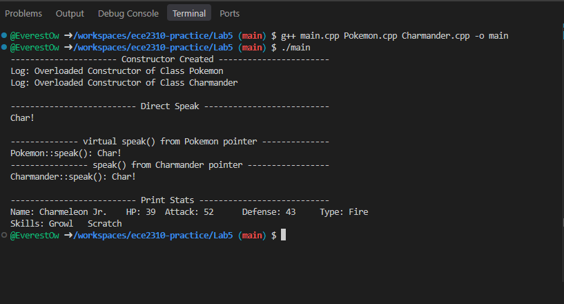

# Lab 5 - Inheritance and Polymorphism
Welcome to the Kanto Region

## Terminal output

## 

*Squirtles not included*

## TODO
- [X] Implement base class Pokemon
- [ ] Meet Professor Oak
- [X] Implement derived class Charmander
- [ ] Implement derived class Squirtle
- [ ] Implement derived class Bulbasaur
- [ ] Add documenting comments to functions